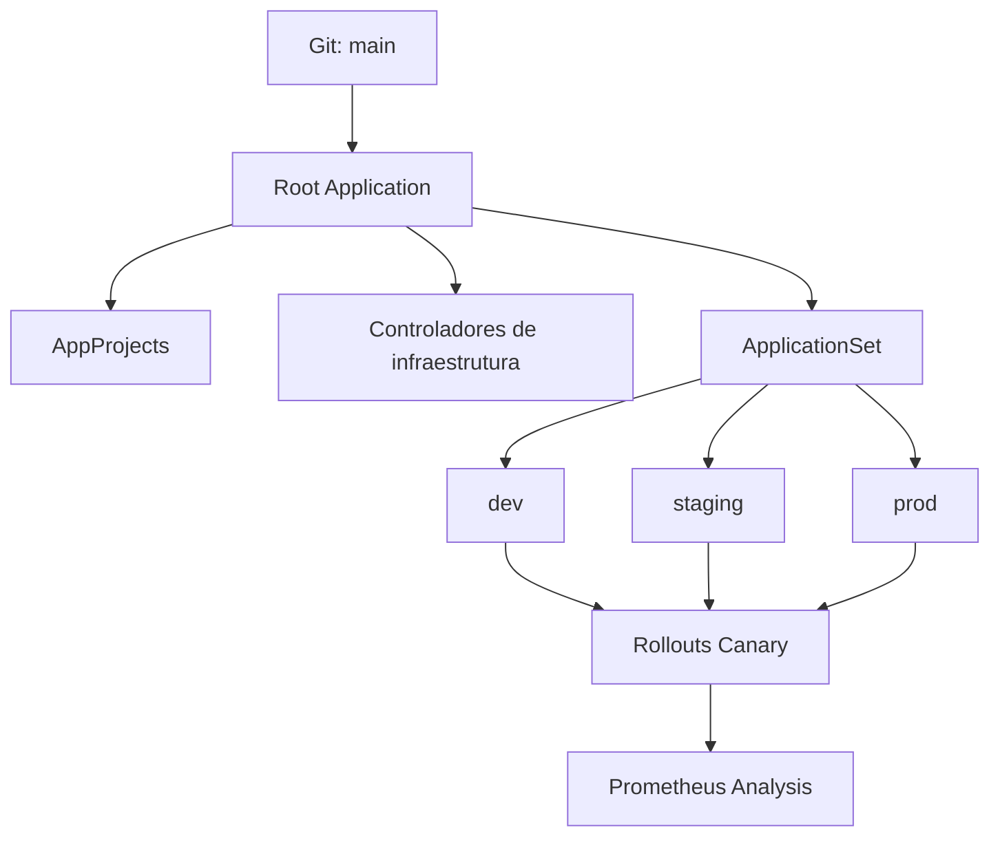

<div align="center">

# GitOps Platform

**Argo CD HA · App-of-Apps · ApplicationSets · Canary · Zero Trust**

[](https://github.com/brunnojob/gitops-platform/actions/workflows/validate.yml)
[](LICENSE)
[](https://github.com/argoproj/argo-cd/releases/tag/v3.6.3)

**Uma fundação GitOps declarativa, revisável e preparada para adaptar ao seu cluster.**

[Arquitetura](#arquitetura) · [Começar](#começar) · [Operação](#operação) · [Segurança](#segurança) · [Limites](#limites-operacionais)

</div>

> [!IMPORTANT]
> Este repositório contém valores de exemplo em `*.example.org`. O bootstrap interrompe a execução até que você configure domínios reais. Publicar o repositório não instala nada no cluster.

## Arquitetura



<details>
<summary><strong>O que cada camada faz?</strong></summary>

| Camada | Responsabilidade |
| --- | --- |
| Bootstrap | Helm fixa o chart do Argo CD; a aplicação raiz inicia a reconciliação. |
| AppProjects | Repositórios e namespaces permitidos; workloads sem recursos privilegiados. |
| ApplicationSet | Descobre `workloads/*/overlays/*` automaticamente. |
| Rollouts | Tráfego canary em 10%, 30%, 60% e 100% via Ingress NGINX. |
| AnalysisTemplate | Consulta HTTP 5xx no Prometheus e aborta canary acima de 5%. |
| Sealed Secrets | Segredos cifrados com a chave pública do controller no cluster. |

</details>

## Começar

### 1. Pré-requisitos

- Kubernetes com DNS e Ingress NGINX; CLI `kubectl`, `helm`, `git` e `argocd`.
- cert-manager e `ClusterIssuer` `letsencrypt-production` configurados.
- Prometheus Operator com CRD `ServiceMonitor` e Prometheus alcançável pelo endpoint configurado no `AnalysisTemplate`.
- Plugin `kubectl argo rollouts` para acompanhar o rollout.

### 2. Ajuste para seu ambiente

Substitua todos os domínios `*.example.org` por domínios que você controla. Configure DNS do Argo CD e dos três endpoints de exemplo; troque a URL do webhook por um endpoint autenticado. Se for usar outro repositório, altere todas as referências a `https://github.com/brunnojob/gitops-platform.git`. Ajuste o seletor `release` do ServiceMonitor e o endereço e labels do Prometheus. Configure OIDC para que `platform-admins`, `platform-deployers` e `platform-readers` tenham membros reais.

```bash
rg 'example\.org|brunnojob/gitops-platform' .
```

### 3. Instale

```bash
chmod +x scripts/bootstrap.sh
./scripts/bootstrap.sh
argocd app wait gitops-platform --sync --timeout 600
argocd app list
```

<details>
<summary><strong>Pré-visualizar manifestos sem instalar</strong></summary>

```bash
kubectl kustomize .
kubectl kustomize workloads/sample-api/overlays/dev
kubectl kustomize workloads/sample-api/overlays/staging
kubectl kustomize workloads/sample-api/overlays/prod
helm template argocd argo/argo-cd --version 10.19.1 -n argocd -f bootstrap/values-argocd.yaml >/dev/null
```

</details>

## Operação

| Ação | Comando |
| --- | --- |
| Comparar | `argocd app diff sample-api-staging` |
| Sincronizar | `argocd app sync sample-api-staging` |
| Aguardar | `argocd app wait sample-api-staging --sync --health --timeout 600` |
| Histórico | `argocd app history sample-api-staging` |
| Rollback emergencial | `argocd app rollback sample-api-staging ID_DO_HISTORICO` |
| Acompanhar canary | `kubectl argo rollouts get rollout sample-api -n sample-api-staging --watch` |

Um rollback manual é temporário com `selfHeal`; reverta a alteração no Git para persistir a versão anterior.

## Segurança

O perfil `deployer` sincroniza apenas `dev` e `staging`. Produção exige o perfil `admin` ou mudança revisada no Git; o controller ainda reconcilia automaticamente o estado aprovado. O projeto de workloads limita os namespaces e bloqueia recursos de RBAC e segredos em texto puro. A chave de Sealed Secrets precisa de backup externo seguro.

<details>
<summary><strong>Criar um SealedSecret para staging</strong></summary>

Depois de instalar o controller:

```bash
kubectl create secret generic sample-api-credentials \
  -n sample-api-staging \
  --from-literal=api-token='VALOR_REAL_FORA_DO_GIT' \
  --dry-run=client -o yaml |
kubeseal --controller-name sealed-secrets-controller \
  --controller-namespace sealed-secrets --format yaml \
  > sample-api-credentials.sealed.yaml
```

Para sincronizar este recurso por Argo CD, autorize `SealedSecret` no AppProject e adicione o arquivo cifrado ao overlay. Nunca versione o Secret original.

</details>

## Limites operacionais

Esta publicação é infraestrutura **como código**, não uma instalação ativa. Antes de produção, valide os charts fixados com a API do seu cluster, as labels do Ingress NGINX usadas pela análise, políticas de rede, backup da chave do Sealed Secrets, disponibilidade do Redis HA e do Prometheus, SSO e regras de revisão da branch `main`. O exemplo `sample-api` usa NGINX sem dados de negócio.

## Licença

[MIT](LICENSE) © 2026 brunnodev.

